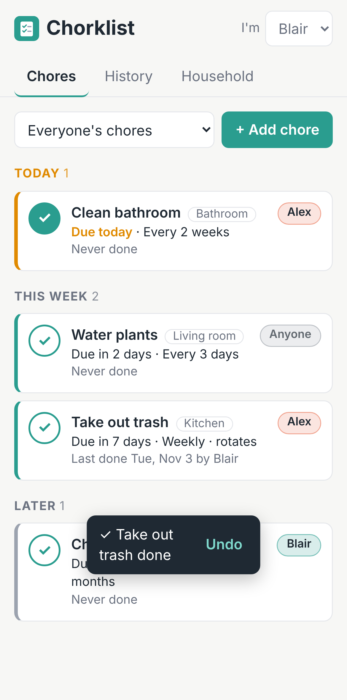

# Chorklist

Track your household's recurring chores (who's on it, when it's due, who did it last) and keep shared lists for groceries, wish lists, movies to watch and more. Everyone in the household uses it from their own iPhone (or any phone or computer) and sees the same shared data.



## Features

- **Recurring schedules**: every N days, weeks, months or years. The next due date counts from when the chore was *actually* done.
- **One-time chores**: untick *Repeats* for a job that only needs doing once. When it's done it leaves the list and stays in the history.
- **At a glance**: chores grouped into Overdue, Today, This week and Later.
- **Shared household**: each person has their own login. One person creates the household and shares an invite code.
- **Assign and rotate**: assign chores to someone (or "Anyone"), filter by person, and optionally pass a chore to the next person each time it's done.
- **One-tap done** with **Undo**, plus a history of who did what. Every chore checked off gets a burst of confetti and a cheer. To show a picture next to "Wow!", add a square image of your choice as `web/wow.jpg`.
- **Shared lists**: groceries, wish lists, movies to watch, anything. Everyone can add and check items, see who added what, and **clear checked items** after a shopping trip.
- **Works like an app on iPhone**: add it to your home screen and it opens full screen with its own icon.
- **Live updates**: when someone marks a chore done or checks off an item, everyone else's screen updates.

## How it works

- **The app** is a static website (the `web/` folder), hosted free on GitHub Pages.
- **The data** is stored in a free [Supabase](https://supabase.com) database, which also handles logins.
- **Security**: the database's security rules (`supabase/schema.sql`) only let people see households they belong to.

No computer of yours needs to stay on.

## One-time setup (about 15 minutes)

### 1. Create the database

1. Sign up at [supabase.com](https://supabase.com) and create a **New project** on the free plan. Pick any name and database password, and the region closest to you.
2. When it's ready, open **SQL Editor** → **New query**.
3. Copy everything in [`supabase/schema.sql`](supabase/schema.sql), paste it in, and click **Run**. You should see "Success. No rows returned".
4. Do the same, one file at a time and in order, for each file in [`supabase/migrations/`](supabase/migrations) (currently [`002_lists.sql`](supabase/migrations/002_lists.sql) and [`003_one_time_chores.sql`](supabase/migrations/003_one_time_chores.sql)).

### Updating an existing setup

When an update adds a new file to `supabase/migrations/`, run **just that file** once in the SQL Editor. Your existing chores and history are not touched. If you skip it, everything else keeps working, and the Lists tab shows a reminder.

### 2. Set up logins

In Supabase, open **Authentication**:

1. Under **URL Configuration**, set **Site URL** to the address where the app will live: `https://ktdisco.github.io/chorklist/`. Also add it under **Redirect URLs**. Then email confirmation and password-reset links come back to the app.
2. *Optional, for easier sign-up:* under **Sign In / Providers** → **Email**, turn off **Confirm email**. People can then start using the app right after creating an account, without checking their email first.

### 3. Connect the app to the database

1. In Supabase, open **Project Settings** → **API** (or click **Connect**). Copy the **Project URL** and the **anon public** key. On newer projects this may be called the **publishable** key, which also works.
2. Edit [`web/config.js`](web/config.js) and paste them in. You can do this right on GitHub: open the file and click the pencil icon.

   ```js
   window.CHORKLIST_CONFIG = {
     supabaseUrl: 'https://abcdefghijk.supabase.co',
     supabaseAnonKey: 'eyJhbGciOi...',
   };
   ```

   This key is meant to be public, so it's safe to commit. **Never** put the `service_role` or secret key here.

### 4. Publish the app with GitHub Pages

1. Merge this branch into `main`.
2. On GitHub, open **Settings** → **Pages** and set **Source** to **GitHub Actions**.
3. The **Publish to GitHub Pages** workflow runs on every push to `main`. When it finishes, the app is live at `https://ktdisco.github.io/chorklist/`.

GitHub Pages is free for public repositories. For a private repository it needs a paid GitHub plan. Alternatively, drag the `web/` folder into [Netlify Drop](https://app.netlify.com/drop) or Cloudflare Pages, which are free, and use that address in step 2 instead.

## Using it on iPhone

1. Open the app's address in **Safari**.
2. Tap the **Share** button → **Add to Home Screen** → **Add**.
3. Open Chorklist from the home screen, tap **Create an account**, and sign up.
4. **First person:** choose **Start a household**. Then, in the **Household** tab:
   - Tap the **house icon** at the top, then add everyone's names.
   - Tap **Share** to text the invite code to the others.
5. **Everyone else:** create an account, then choose **Join a household** and enter the code.
6. Pick your name in the **I'm** menu at the top, so chores you tick off are credited to you.

- **Chores tab:** tap **+ Add chore** to add chores, tap ✓ when one is done, and tap a chore to edit it.
- **Lists tab:** tap **+ New list**, then type items and press return to add several in a row. Tick items as you go, and tap **Clear checked** when you're done.
- **Household button** (the house icon at the top): people, invite code, and your account.

## Good to know

- **Free-tier pausing:** Supabase pauses free projects after about a week with no activity. Regular use keeps it awake. If it ever pauses, click **Restore** in the Supabase dashboard; your data is kept.
- **People without accounts:** the names on the Household screen are just labels. A child can have chores assigned without needing their own account.
- **Backups:** Supabase → **Table Editor** lets you view and export your data as CSV.

## Development

```sh
npm run dev   # preview web/ at http://localhost:3000 (uses the Supabase project in config.js)
npm test      # schedule tests; database tests too if CHORKLIST_TEST_PG is set
```

To also test the database rules against a local PostgreSQL 15+ server:

```sh
CHORKLIST_TEST_PG=postgres://postgres@localhost:5432/postgres npm test
```

### Project layout

| Path | What it is |
| --- | --- |
| `web/index.html`, `web/styles.css` | The app's screens and styling |
| `web/app.js` | UI logic |
| `web/db.js` | All communication with Supabase |
| `web/schedule.js` | Due date math (shared with the tests) |
| `web/celebrate.js` | Confetti and cheers when a chore is checked off |
| `web/config.js` | Your Supabase project URL and anon key |
| `supabase/schema.sql` | Tables, security rules, and the complete/undo/rotate functions |
| `supabase/migrations/` | Later database updates, run in order (e.g. `002_lists.sql` for shared lists, `003_one_time_chores.sql` for one-time chores) |
| `supabase/tests/` | Database tests run against plain PostgreSQL |
| `.github/workflows/pages.yml` | Tests and publishes `web/` to GitHub Pages |
